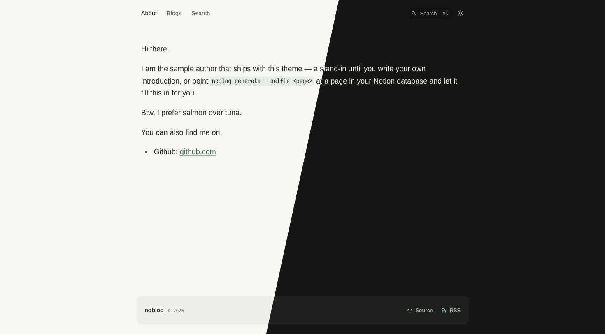
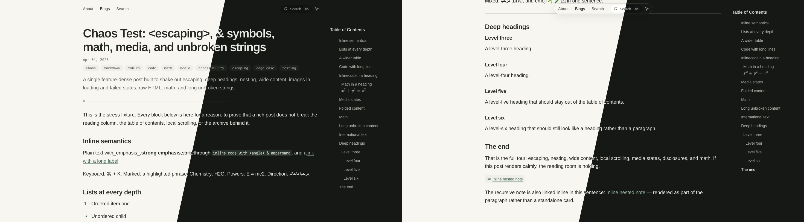
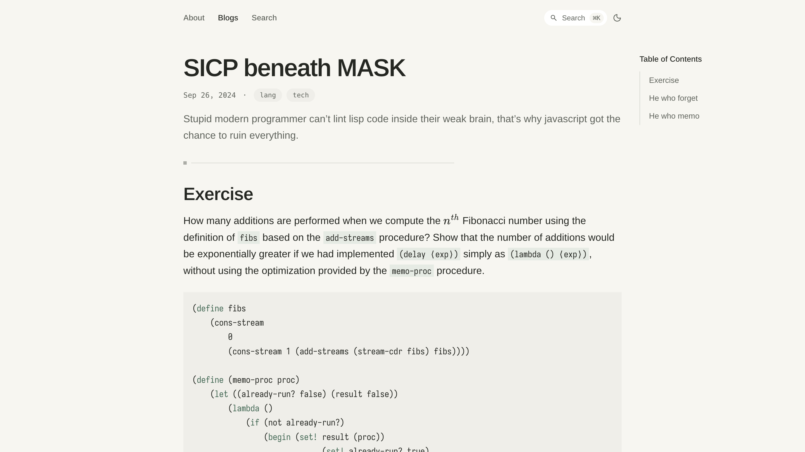
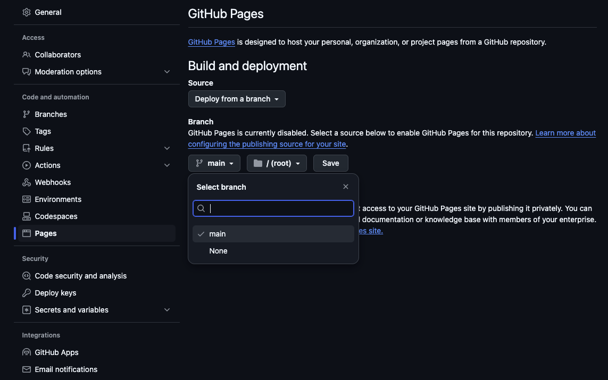

# nobloger

A astro start template for [noblog](https://github.com/humbornjo/noblog)

Demo deployed at [blog.humbornjo.com](https://blog.humbornjo.com)

nobloger is

- simple, llight-weight and elegant
- using full static pages (deal with nested notion pages)
- with easy deployment





# usage

## local development

Local generation uses the sibling [noblog](https://github.com/humbornjo/noblog) checkout at `../noblog` through an optional `file:` dependency. Use Node 24 or newer, then configure `NOTION_API_SECRET` and `NOBLOG_DATABASE_ID` in `.env` or the environment.

```sh
pnpm install
pnpm noblog:check
pnpm noblog:generate
pnpm dev
```

`noblog.yaml` contains only content mapping and output settings, never credentials. Generation writes every page to `.noblog/pages/` and creates public symlinks for database posts in `src/pages/posts/`. Both locations are generated and ignored; do not edit their Markdown by hand. Canonical child pages are rendered by `src/pages/posts/nob_children/[id].astro` at the existing `/posts/nob_children/<id>/` URLs.

Generation is explicit and is not part of `dev` or `build`, so frontend work does not require Notion access. GitHub Pages deployment remains unchanged: CI installs the registry CLI and generates legacy nested Markdown routes, which the theme also supports.

## github page deploy

1. Duplicate [this notion database](https://www.notion.so/humbornjo/fa0faae85c504934a4a86cfa70302850?v=2abd1079ae134fbd8df2604765baa1df) and migrate all your posts into it. If you are not a notion player, just simply put your blog under "./src/pages/posts/"

   ```
   # dont forget to add frontmatter if you are not a notion player
   ---
   layout: ../../layouts/MarkdownPostLayout.astro
   title: "golang @any%"
   tags: ["lang"]
   pubDate: 2024-01-24
   archived: false
   description: ""
   ---
   ```

2. Fork this project, modify the file `selfie.md` under `public` folder as your self introduction, modify `astro.config.mjs` as following.

   ```
   site: 'https://<YOUR_USER_NAME>.github.io',
   base: '/<REPO_NAME>',
   ```

3. Goto "Settings -> Secrets and variables -> actions", add following two secrets to "Repository secrets":

   - `NOBLOG_DATABASE_ID`: your notion database id.
   - `NOTION_API_SECRET`: your notion api secret.

4. Goto "Settings -> Pages" and enable pages by set branch as "main", and source as "Github Actions".
   

5. Goto "Actions -> Deploy to GitHub Pages", press "Run workflow", and press the poped up green "Run workflow".

6. Wait a few minutes, and visit https://\<YOUR_USER_NAME\>.github.io/\<REPO_NAME\>

Enjoy.

# todo

- [x] fix markdown display matter
- [x] add "search" in blog page
- [x] add "sort by time" in blog page
- [ ] ~~add "paginator" for blog page~~ (is it necessary to use paginator while having nested page?)
- [ ] better tag selection page, filtering w/ multi-select

# help

- notion api: [https://developers.notion.com](https://developers.notion.com)
- notion database id:
  ```bash
  # suppose your notion databsae url is "https://www.notion.so/humbornjo/fa0faae85c504934a4a86cfa70302850?v=2abd1079ae134fbd8df2604765baa1df"
  # then your database id is "fa0faae85c504934a4a86cfa70302850"
  ```
- notion host file and image on aws s3, and **all such files has a expire time**, it appears that the only way is modifying the workflow to deploy page every 2 hours.

  ```bash
  name: Deploy to GitHub Pages

  on:
    # Schedule the workflow to run every 2 hours
    schedule:
      - cron: '0 */2 * * *'
  ```

- If you want to use \[SPACE\] in between math delimiter like "$" and "$$", don't use "~", use "\ " instead.
- [enable github pages](https://tomcam.github.io/least-github-pages/enable-github-pages.html), don't forget to click "save".

# reference

- Font:
  - [Hack Dejavu](https://github.com/pawroman/zola-theme-terminimal/)
- Style:
  - [Terminimal](https://github.com/pawroman/zola-theme-terminimal/)
  - [astro-nano](https://github.com/markhorn-dev/astro-nano)
- TexMath Renderer:
  - [MathJax](https://docs.mathjax.org/en/latest/web/configuration.html)
